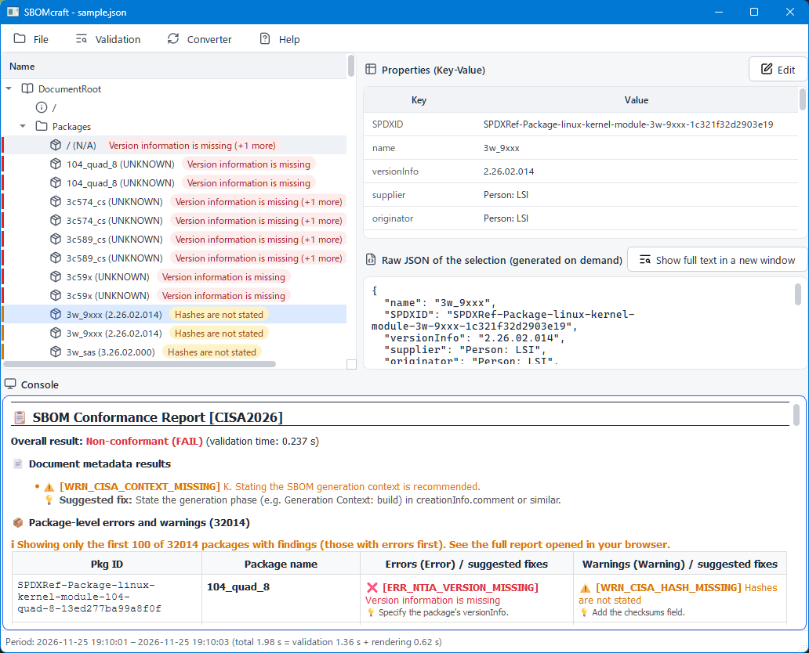
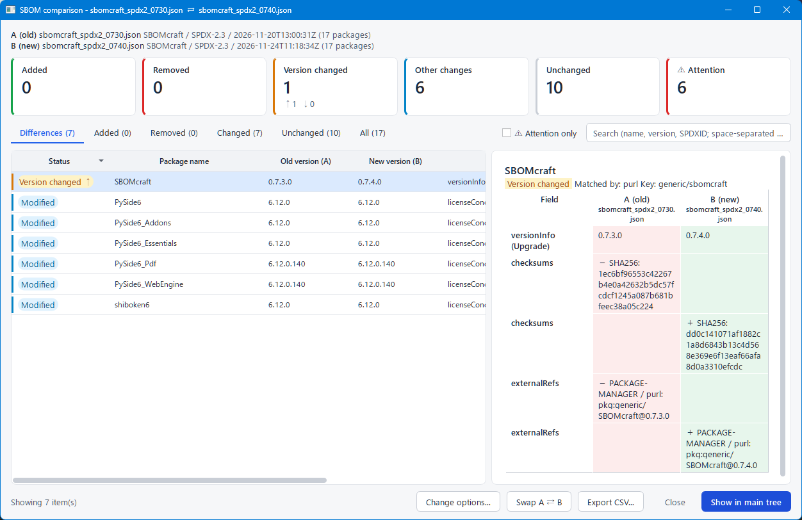

# SBOMcraft

 [English](readme.md) | [日本語](readme_ja.md)

SBOMcraft is a lightweight Windows desktop application for viewing, editing, validating, comparing, and converting Software Bill of Materials (SBOM) documents.

It supports SPDX 2.3 JSON import/export and provides experimental SPDX 3.1 JSON-LD generation. SBOMcraft also includes validation features based on NTIA minimum elements and CISA's 2026 minimum SBOM requirements.

## Features

- Fast SPDX 2.3 JSON parsing and visualization
- SPDX 2.3 JSON editing
- Experimental SPDX 3.1 JSON-LD export
- NTIA minimum elements validation
- CISA 2026 minimum requirements validation
- SPDX license verification
- Excel integration for bulk editing
- SBOM comparison and change analysis
- Drag & Drop support
- Japanese and English user interface

## Multi-language Support

SBOMcraft supports both Japanese and English user interfaces.

The display language is automatically selected based on the Windows display language and can also be changed manually within the application.

## Supported Formats

### Input

- SPDX 2.3 JSON

### Output

- SPDX 2.3 JSON
- SPDX 3.1 JSON-LD (experimental)

## Main Functions

### Fast and Responsive SBOM Loading

- Uses QThread-based background processing to keep the UI responsive while loading large SPDX documents.
- Parsing progress is displayed in real time in the log panel.

### Hierarchical Tree View and JSON Viewer

- Browse SBOM structures using an intuitive tree view.
- View component details and the corresponding JSON source side by side.

### NTIA / CISA Validation

- Validate SBOM documents against NTIA minimum elements.
- Validate against CISA 2026 minimum SBOM requirements.
- Highlight validation issues directly in the tree view.
- Designed to perform efficiently even with large SBOM files.
- Automatically generate detailed validation reports.
- For cases with more than 100 findings, an HTML file is generated and displayed in a browser.

> **Note**
>
> The validation engine is an independent implementation provided by SBOMcraft and is not an official NTIA or CISA validation tool.
>
> For validation details, see `VALIDATION_RULE_CISA2026.md`.

### SPDX 3.1 JSON-LD Conversion

- Convert SPDX 2.3 JSON documents into SPDX 3.1 JSON-LD format.
- This feature is currently experimental and supports a limited set of fields.

### License Verification

- Retrieve SPDX License information.
- Check license identifiers used in the SBOM against SPDX License List definitions.
- Export validation results to CSV format.

### SBOM Editing

- Edit package information directly from the GUI.
- Save modifications back to the SBOM document.
- Export package information to Excel.
- Import modified Excel files back into the SBOM.

For details, see `excel_integration_guide.md`.

### SBOM Comparison

- Compare the currently opened SBOM with another SBOM file.
- Compare the original file with the currently edited content.
- Detect additions, removals, version changes, and other modifications.
- Multiple matching methods are available:
  - Automatic (purl → name)
  - SPDXID
  - Name + Version
  - Name Only
  - purl Only
- Highlight potentially important changes such as checksum mismatches.
- Export comparison results to CSV.

### Drag & Drop Support

- Open SBOM files by dragging them into the application window.
- Dropping two files simultaneously automatically starts a comparison.
- More than two files dropped at once are not supported.

## Screenshot

### Main & Validation

### Compare

## Download

Executable files are available from the GitHub Releases page.

## System Requirements

- Windows 10 (64-bit)
- Windows 11 (64-bit)

No additional runtime installation is required.

The distributed executable includes all required Python runtime components.

## Important Notes

On first launch, Windows SmartScreen may display a warning because the application is currently unsigned.

Select:

**More info → Run anyway**

to start the application.

## Development

SBOMcraft is developed with the assistance of generative AI tools.

AI-generated code and validation logic are reviewed and tested before release.

## License

SPDX-License-Identifier: Apache-2.0

## Credits

Developed by XZ Manj